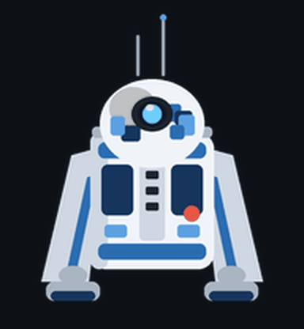

# R2-D2 для Hermes Agent 💚

Анимированный питомец-астромех **R2-D2** для [Hermes Agent](https://github.com/NousResearch/hermes-agent):
спрайт-атлас в формате [petdex](https://github.com/crafter-station/petdex), нарисованный **кодом**
(чистый Python + Pillow, без image-моделей), плюс речевой пузырь на русском и режим прогулки по экрану.



Слева — вид анфас (стоит), справа — профиль (едет):


---

## Зачем это

В галерее petdex больше 5200 питомцев, но R2-D2 там нет (ближайшие — `droid`, `r2-vader`,
`mandalorian`). Штатный путь «вырастить» питомца через `/hatch` требует image-модели с поддержкой
референсных изображений (`nous`, `openai`, `openrouter`, `krea`), а бесплатный ключ OpenRouter
отдаёт `402 Insufficient credits` на любой модели.

Поэтому атлас собран программно: 54 кадра (9 состояний × 6 кадров) рисуются одной параметрической
функцией. Это даёт полную согласованность кадров, нулевую стоимость и возможность править позы
одной строкой.

## Что внутри

```
pet/spritesheet.png   готовый атлас 1536×1872 (8×9 ячеек по 192×208)
pet/pet.json          метаданные питомца для Hermes
scripts/draw_r2d2_pet.py  генератор атласа (единственный источник правды)
desktop-plugins/r2-voice/plugin.js  плагин речевого пузыря
docs/                 превью и картинки
```

---

## Формат атласа (контракт petdex)

| Параметр | Значение |
|---|---|
| Размер полотна | **1536 × 1872** |
| Сетка | 8 колонок × 9 строк |
| Ячейка | **192 × 208** |
| Кадров в состоянии | 6 (колонки 7–8 остаются прозрачными) |
| Порядок строк | `idle`, `running-right`, `running-left`, `waving`, `jumping`, `failed`, `waiting`, `running`, `review` |

`running-left` не рисуется отдельно — это зеркало `running-right` по кадрам (так спецификация и
задумана: рендерер не переворачивает спрайт, а берёт готовую строку).

Установка:

```bash
mkdir -p ~/.hermes/pets/r2d2
cp pet/spritesheet.png pet/pet.json ~/.hermes/pets/r2d2/
hermes pets select r2d2          # запишет display.pet.slug и включит показ
hermes config set display.pet.scale 0.4   # размер (по умолчанию 0.33)
```

Проверка атласа встроенным валидатором:

```bash
~/.hermes/hermes-agent/venv/bin/python - <<'PY'
import sys; sys.path.insert(0, '/home/pi/.hermes/hermes-agent')
from PIL import Image
from agent.pet.generate import atlas as A
print(A.validate_atlas(Image.open('/home/pi/.hermes/pets/r2d2/spritesheet.png')))
PY
```

---

## Как нарисовано

### 1. Суперсэмплинг

PIL не сглаживает фигуры, поэтому всё рисуется в 4× (768×832 на ячейку) и уменьшается
`Image.LANCZOS` до 192×208. Это единственный способ получить чистые края без внешних библиотек.

### 2. Параметрическая функция вместо 54 отдельных картинок

```python
draw_droid(...)        # анфас: eye_open, eye_color, dome_turn, leg_phase, arm_out,
                       #         squeeze, third_leg, body_light
draw_droid_side(...)   # профиль: то же + lean, rolling, wheel, dust
```

Все кадры получаются из одной функции — позы физически согласованы между состояниями.

### 3. Сагиттальная плоскость для движения

Ключевая находка: если рисовать питомца анфас и просто сдвигать его по горизонтали, он «скользит
боком». Поэтому локомоция (`running-right`, `running`, `jumping`) нарисована **в профиль** — по
студийному чертежу R2-D2 (starboard elevation): купол-полусфера с выступающим «радарным глазом»,
корпус-цилиндр с прямыми стенками, широкая боковая нога с плечевым диском и трапециевидной
ступнёй, третья нога — отдельная стойка.

### 4. Три слоя и физика опор

```
chassis  (дальняя нога + третья нога с гусеницей) — не наклоняется
torso    (корпус + купол)                        — наклоняется назад на ~10°
near leg (ближняя нога)                          — сверху корпуса, стоит на земле
```

Вращение torso вокруг оси ног, а не всей картинки: иначе ступни отрываются от земли и питомец
«висит в воздухе». Контакт проверяется численно, а не на глаз:

```python
# низ каждой опоры должен быть равен BASE_Y = 190
for i in range(6):
    frame, _ = frame_('running-right', i)
    assert bottom_of(frame, 42, 72)  == 190   # дальняя нога
    assert bottom_of(frame, 74, 96)  == 190   # гусеница
    assert bottom_of(frame, 100, 140) == 190  # ближняя нога
```

### 5. Цикл ходьбы без «замёрших» кадров

Шесть кадров, снятых с синуса, дают дубли (sin 60° == sin 120°) — походка выглядит застывшей.
Используется треугольная фаза:

```python
cycle = (0.0, 0.7, 1.0, 0.0, -0.7, -1.0)
```

### 6. Гусеница, колёса и пыль

* гусеничный привод — только на **третьей** ноге: кожух, лента, бегущие траки, ролик;
* на боковых ногах — колёса у пятки с вращающимися метками (фаза сдвинута на 0.3, чтобы колёса не
  крутились синхронно);
* пыль — три полупрозрачных пятна за шасси, `GaussianBlur(3)`; сила задаётся кривой
  `(0.30, 0.65, 0.95, 0.75, 0.45, 0.20)` — разгорается к 3-му кадру и рассеивается к 6-му.

### Палитра

| Роль | Hex |
|---|---|
| белый корпус | `#F0F4F9` |
| белый в тени / светлый серый | `#CED7E2` |
| серый ступней | `#AAB5C2` |
| синий | `#2B6CB0` |
| тёмно-синий | `#16345C` |
| светло-синий | `#5CA0E2` |
| серебро (диски, антенны) | `#98A4B1` |
| тёмное (объектив, жалюзи) | `#1C222C` |
| линза-фоторецептор | `#6ECDFF` |
| индикатор | `#E45646`, в работе — `#FFC054` |

---

## Речевой пузырь: «Голос R2»

В окне приложения штатный пузырь показывает только строки плагинов, поэтому реплики идут через
штатную «пет-дверь» `ctx.pet.say`.

```js
ctx.onEvent('tool.start', () => ctx.pet.say('кручу гайки…', { id: 'r2-voice', ttlMs: 8000 }))
```

| Событие | Реплики |
|---|---|
| `message.start` | «берусь за дело…», «так, поехали…» |
| `tool.start` | «кручу гайки…», «ковыряюсь в системе…», «смотрю файлы…» |
| `turn.settled` / `message.complete` | «готово, Артём ✨», «всё, твой ход…» |
| `message.error` | «упс, сломалось…» (красный тон) |
| тишина >60 с | «проверяю датчики…», «не сплю…» |

Ограничения хоста: 120 символов на строку, TTL 1–30 с, ≤3 живых строк, 10 `say` за 10 с — плагин
сам тормозит себя до одной фразы в 3.5 с.

Подпись с именем плагина над репликой хост рисует безусловно; она скрывается стилем, который
плагин внедряет при загрузке и убирает при выгрузке:

```css
[data-slot="pet-plugin-bubble"] > span:first-child { display: none !important; }
```

Установка плагина:

```bash
mkdir -p ~/.hermes/desktop-plugins/r2-voice
cp desktop-plugins/r2-voice/plugin.js ~/.hermes/desktop-plugins/r2-voice/
# затем перезагрузить страницу/приложение — плагин подхватится с диска
```

---

## Прогулка (roam)

Включается в Настройках → Питомец (или `hermes.desktop.pet-roam.v1 = "true"` в `localStorage`).
Внутри Hermes это условие `roamEnabled && active && !overlayActive && atRest`: пока агент работает,
питомец стоит и показывает его состояние; как только работа закончилась — выбирает цель, идёт,
иногда прыгает на «уступ», падает с гравитацией и отдыхает 1.5–13 с.

---

## Как перегенерировать

```bash
# нужен Pillow
~/.hermes/hermes-agent/venv/bin/python scripts/draw_r2d2_pet.py out.png   # атлас целиком
```

Отдельные кадры для отладки:

```python
import draw_r2d2_pet as m
frame, bob = m.frame('running-right', 2)   # кадр 3 из 6, плюс вертикальный сдвиг
frame.save('one.png')
```

Константы для правки: `CELL_W`, `CELL_H`, `BASE_Y` (линия земли), `SS` (суперсэмплинг).

---

## Лицензия и оговорка

Код и нарисованный спрайт — **MIT**, делай что хочешь.

R2-D2, Star Wars и связанные образы — товарные знаки Lucasfilm Ltd. Это фанатская работа, не
связанная с Lucasfilm/Disney, без коммерческого использования. Референсом служил публично
опубликованный студийный чертёж «Starboard Elevation» (20th Century Fox, 1977) и открытые описания
терминологии астромеха; сами файлы чертежей в репозиторий не включены.
