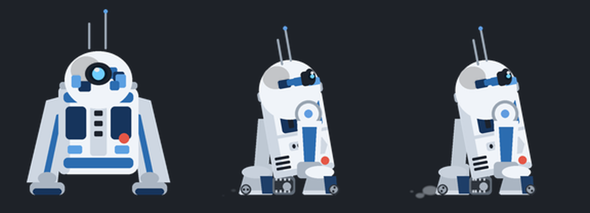

# R2-D2 для Hermes Agent 💚

Анимированный питомец-астромех **R2-D2** для [Hermes Agent](https://github.com/NousResearch/hermes-agent):
спрайт-атлас в формате [petdex](https://github.com/crafter-station/petdex), нарисованный **кодом**
(чистый Python + Pillow, без image-моделей), плюс речевой пузырь на русском и режим прогулки по экрану.


Слева — вид анфас (стоит), справа — профиль (едет):



---

## Зачем это

В галерее petdex больше 5200 питомцев, но R2-D2 там нет (ближайшие — `droid`, `r2-vader`,
`mandalorian`). Штатный путь «вырастить» питомца через `/hatch` требует image-модели с поддержкой
референсных изображений (`nous`, `openai`, `openrouter`, `krea`), а бесплатный ключ OpenRouter
отдаёт `402 Insufficient credits` на любой модели.

Поэтому атлас собран программно: 54 кадра (9 состояний × 6 кадров) рисуются одной параметрической
функцией. Это даёт полную согласованность кадров, нулевую стоимость и возможность править позы
одной строкой.

## Что внутри

```
pet/spritesheet.png   готовый атлас 1536×1872 (8×9 ячеек по 192×208)
pet/pet.json          метаданные питомца для Hermes
scripts/draw_r2d2_pet.py  генератор атласа (единственный источник правды)
desktop-plugins/r2-voice/plugin.js  плагин речевого пузыря
docs/                 превью и картинки
```

---

## Формат атласа (контракт petdex)

| Параметр | Значение |
|---|---|
| Размер полотна | **1536 × 1872** |
| Сетка | 8 колонок × 9 строк |
| Ячейка | **192 × 208** |
| Кадров в состоянии | 6 (колонки 7–8 остаются прозрачными) |
| Порядок строк | `idle`, `running-right`, `running-left`, `waving`, `jumping`, `failed`, `waiting`, `running`, `review` |

`running-left` не рисуется отдельно — это зеркало `running-right` по кадрам (так спецификация и
задумана: рендерер не переворачивает спрайт, а берёт готовую строку).

Установка:

```bash
H="${HERMES_HOME:-$HOME/.hermes}"
mkdir -p "$H/pets/r2d2"
cp pet/spritesheet.png pet/pet.json "$H/pets/r2d2/"
hermes pets select r2d2          # запишет display.pet.slug и включит показ
hermes config set display.pet.scale 0.4   # размер (по умолчанию 0.33)
```

Проверка атласа встроенным валидатором:

```bash
~/.hermes/hermes-agent/venv/bin/python - <<'PY'
import sys; sys.path.insert(0, '/home/pi/.hermes/hermes-agent')
from PIL import Image
from agent.pet.generate import atlas as A
print(A.validate_atlas(Image.open('/home/pi/.hermes/pets/r2d2/spritesheet.png')))
PY
```

---

## Установка без git — пошагово через терминал

Git не нужен: все файлы лежат в репозитории по прямым ссылкам, и Hermes забирает питомца из
`~/.hermes/pets/<slug>/` — то есть достаточно скачать два файла в нужную папку. Ниже — весь путь
командами, по одному шагу, с проверками после каждого.

Все команды выполняются на той машине, где живёт Hermes (у нас — Pi4).

### Шаг 0. Убедиться, что Hermes на месте

```bash
hermes --version
hermes pets --help | head -3
H="${HERMES_HOME:-$HOME/.hermes}"; echo "дом Hermes: $H"
ls -d "$H/pets" 2>/dev/null || echo "папки pets пока нет — создастся на шаге 2"
```

### Шаг 1. Задать адрес репозитория (чтобы не повторять длинные URL)

```bash
REPO=https://raw.githubusercontent.com/Haidegger22/hermes-r2d2-pet/main
```

### Шаг 2. Создать папки и скачать файлы

```bash
H="${HERMES_HOME:-$HOME/.hermes}"
mkdir -p "$H/pets/r2d2" "$H/desktop-plugins/r2-voice"

# спрайт-атлас (423 КБ) — сам питомец
curl -fsSL -o "$H/pets/r2d2/spritesheet.png" "$REPO/pet/spritesheet.png"

# метаданные: имя, описание, откуда брать картинку
curl -fsSL -o "$H/pets/r2d2/pet.json" "$REPO/pet/pet.json"

# плагин речевого пузыря (необязательно, можно поставить позже)
curl -fsSL -o "$H/desktop-plugins/r2-voice/plugin.js" \
  "$REPO/desktop-plugins/r2-voice/plugin.js"
```

Флаг `-f` важен: с ним `curl` падает с ошибкой на 404 вместо того, чтобы записать в файл страницу
«Not Found» (иначе получится битый PNG, и питомец молча не появится).

### Шаг 3. Проверить, что скачалось именно то

```bash
H="${HERMES_HOME:-$HOME/.hermes}"
ls -l "$H/pets/r2d2/"
file "$H/pets/r2d2/spritesheet.png"
cat "$H/pets/r2d2/pet.json"
```

Ожидаемо: `spritesheet.png` — PNG 1536×1872, размер около 423 КБ; `pet.json` — короткий JSON с
`"id": "r2d2"`, `"displayName": "R2-D2"` и `"spritesheetPath": "spritesheet.png"`.

Строгая проверка атласа встроенным валидатором Hermes (тот самый, что у petdex):

```bash
~/.hermes/hermes-agent/venv/bin/python - <<'PY'
from PIL import Image
from agent.pet.generate import atlas as A
import sys
sys.path.insert(0, '/home/pi/.hermes/hermes-agent')
img = Image.open('/home/pi/.hermes/pets/r2d2/spritesheet.png')
print(A.validate_atlas(img))
PY
```

Если путь к питону Hermes другой (другая раскладка установки) — найти его так:

```bash
find ~ -maxdepth 5 -path '*hermes-agent/venv/bin/python' 2>/dev/null | head -3
```

Проверка необязательная: для одного питомца достаточно `file` выше (PNG 1536×1872). Валидатор
нужен, если ты собрал атлас сам и хочешь убедиться, что сетка и состояния на месте.

### Шаг 4. Включить питомца

```bash
hermes pets select r2d2           # запишет display.pet.slug=r2d2 и включит показ
hermes config set display.pet.enabled true
hermes config get display.pet     # проверка: enabled: true, slug: r2d2
hermes pets list --installed      # ожидаемо: "r2d2   R2-D2"
```

Размер подгоняется одной командой (0.1 … 3.0, по умолчанию 0.33):

```bash
hermes pets scale 0.45
```

Питомец появляется сразу в CLI/TUI; в десктопе и вебаппе — после перезагрузки страницы или
приложения (рендерер забирает атлас при старте).

### Шаг 5. Включить прогулку по экрану (только вебапп/десктоп)

Это настройка рендерера, CLI-команды у неё нет. Два способа:

* через интерфейс: **Настройки → Питомец → «Гуляет»**;
* через консоль браузера (F12 → Console) на странице вебаппа:

```js
localStorage.setItem('hermes.desktop.pet-roam.v1', 'true')
location.reload()
```

Выключить обратно — тем же ключом со значением `'false'`.

### Шаг 6. Перезагрузить плагин голоса

Плагины десктопа читаются с диска при старте: достаточно перезагрузить страницу вебаппа или
перезапустить десктоп-приложение. Если приложение нативное и хочется наверняка:

```bash
systemctl --user restart hermes-gateway     # перезапустит шлюз и подтянет плагины
```

Проверка, что пузырь живой: в консоли браузера (на странице вебаппа) через пару секунд после
перезагрузки:

```js
document.querySelector('[data-slot="pet-plugin-bubble"]')?.innerText
```

Должно появиться приветствие «на связи, Артём ✨» (или любая реплика по событию).

### Шаг 7. Полный архив без git (альтернатива пошаговой загрузке)

Если удобнее забрать всё разом — GitHub отдаёт tarball ветки:

```bash
cd /tmp
curl -fL -o r2.tgz https://github.com/Haidegger22/hermes-r2d2-pet/archive/refs/heads/main.tar.gz
tar xzf r2.tgz
H="${HERMES_HOME:-$HOME/.hermes}"
mkdir -p "$H/pets/r2d2" "$H/desktop-plugins/r2-voice"
cp hermes-r2d2-pet-main/pet/spritesheet.png hermes-r2d2-pet-main/pet/pet.json "$H/pets/r2d2/"
cp hermes-r2d2-pet-main/desktop-plugins/r2-voice/plugin.js "$H/desktop-plugins/r2-voice/"
```

### Шаг 8. Откат и удаление

```bash
H="${HERMES_HOME:-$HOME/.hermes}"
hermes pets off                              # спрятать, не удаляя файлы
hermes pets remove r2d2                      # или: rm -rf "$H/pets/r2d2"
rm -rf "$H/desktop-plugins/r2-voice"         # убрать речевой пузырь
hermes config set display.pet.enabled false  # если питомец не нужен совсем
```

Ничего, кроме этих путей, установка не трогает: конфиг правится только через
`hermes config set`, поэтому откат — это те же три шага в обратную сторону.

### Шаг 9. Что проверить после установки

```bash
hermes pets doctor                # видит ли Hermes питомца и какой режим отрисовки
hermes pets show r2d2 --cycle     # проиграть все 9 состояний в терминале
hermes pets list --installed      # r2d2 в списке
```

`hermes pets doctor` печатает `pets dir`, `enabled`, `slug` и `detected graphics`. Если там
`effective mode (TTY): off` — это про отрисовку в терминале, на десктоп/вебапп не влияет.

Важно: **в конвейере и при перенаправлении вывода питомец не рисуется** (`hermes … | tee`,
`> log`) — это поведение хоста, а не поломка. Смотреть анимацию нужно в интерактивном TUI или в
окне приложения/вебаппа.

---

## Как нарисовано

### 1. Суперсэмплинг

PIL не сглаживает фигуры, поэтому всё рисуется в 4× (768×832 на ячейку) и уменьшается
`Image.LANCZOS` до 192×208. Это единственный способ получить чистые края без внешних библиотек.

### 2. Параметрическая функция вместо 54 отдельных картинок

```python
draw_droid(...)        # анфас: eye_open, eye_color, dome_turn, leg_phase, arm_out,
                       #         squeeze, third_leg, body_light
draw_droid_side(...)   # профиль: то же + lean, rolling, wheel, dust
```

Все кадры получаются из одной функции — позы физически согласованы между состояниями.

### 3. Сагиттальная плоскость для движения

Ключевая находка: если рисовать питомца анфас и просто сдвигать его по горизонтали, он «скользит
боком». Поэтому **движение** (`running-right`, `running-left`) нарисовано **в профиль** — по
студийному чертежу R2-D2 (starboard elevation): купол-полусфера с выступающим «радарным глазом»,
корпус-цилиндр с прямыми стенками, широкая боковая нога с плечевым диском и трапециевидной
ступнёй, третья нога — отдельная стойка с гусеницей.

Состояние `running` (агент работает — то есть сразу после того, как пользователь отправил запрос)
наоборот рисуется **анфас**: питомец смотрит на тебя, а над куполом **мигает лампочка** —
жёлтый огонёк с ореолом, который загорается на трёх кадрах из шести. Так видно, что запрос принят
и работа идёт, даже если окно чата не на переднем плане.

### 3a. Почему фронтальные кадры симметричны

Хост зеркалит спрайт (`scaleX(-1)`), когда центр питомца оказывается на левой половине окна — это
правильно для питомцев petdex, чей арт нарисован «смотрящим влево». Наш анфас нарисован строго
**зеркально-симметричным**: антенны равной длины и на равном расстоянии от центра, пара
одинаковых индикаторов, панели купола — зеркальными парами, блик по центру. Поэтому зеркалирование
ничего не меняет: на левой и правой половине экрана R2-D2 выглядит одинаково.

Проверяется численно — кадр против своего отражения:

```python
frame, _ = frame_('idle', 0)
diff = ImageChops.difference(frame, frame.transpose(Image.FLIP_LEFT_RIGHT))
# остаются только 1–2 px сглаживания, крупных отличий быть не должно
```

Симметрия сохранена **только для анфасных состояний**; профиль (`running-right/left`) намеренно
асимметричен — он и не переворачивается, потому что хост берёт готовую левую строку.

### 4. Три слоя и физика опор

```
chassis  (дальняя нога + третья нога с гусеницей) — не наклоняется
torso    (корпус + купол)                        — наклоняется назад на ~10°
near leg (ближняя нога)                          — сверху корпуса, стоит на земле
```

Вращение torso вокруг оси ног, а не всей картинки: иначе ступни отрываются от земли и питомец
«висит в воздухе». Контакт проверяется численно, а не на глаз:

```python
# низ каждой опоры должен быть равен BASE_Y = 190
for i in range(6):
    frame, _ = frame_('running-right', i)
    assert bottom_of(frame, 42, 72)  == 190   # дальняя нога
    assert bottom_of(frame, 74, 96)  == 190   # гусеница
    assert bottom_of(frame, 100, 140) == 190  # ближняя нога
```

### 5. Цикл ходьбы без «замёрших» кадров

Шесть кадров, снятых с синуса, дают дубли (sin 60° == sin 120°) — походка выглядит застывшей.
Используется треугольная фаза:

```python
cycle = (0.0, 0.7, 1.0, 0.0, -0.7, -1.0)
```

### 6. Гусеница, колёса и пыль

* гусеничный привод — только на **третьей** ноге: кожух, лента, бегущие траки, ролик;
* на боковых ногах — колёса у пятки с вращающимися метками (фаза сдвинута на 0.3, чтобы колёса не
  крутились синхронно);
* пыль — три полупрозрачных пятна за шасси, `GaussianBlur(3)`; сила задаётся кривой
  `(0.30, 0.65, 0.95, 0.75, 0.45, 0.20)` — разгорается к 3-му кадру и рассеивается к 6-му.

### Палитра

| Роль | Hex |
|---|---|
| белый корпус | `#F0F4F9` |
| белый в тени / светлый серый | `#CED7E2` |
| серый ступней | `#AAB5C2` |
| синий | `#2B6CB0` |
| тёмно-синий | `#16345C` |
| светло-синий | `#5CA0E2` |
| серебро (диски, антенны) | `#98A4B1` |
| тёмное (объектив, жалюзи) | `#1C222C` |
| линза-фоторецептор | `#6ECDFF` |
| индикатор | `#E45646`, в работе — `#FFC054` |

---

## Речевой пузырь: «Голос R2»

В окне приложения штатный пузырь показывает только строки плагинов, поэтому реплики идут через
штатную «пет-дверь» `ctx.pet.say`.

```js
ctx.onEvent('tool.start', () => ctx.pet.say('кручу гайки…', { id: 'r2-voice', ttlMs: 8000 }))
```

| Событие | Реплики |
|---|---|
| `message.start` | «берусь за дело…», «так, поехали…» |
| `tool.start` | «кручу гайки…», «ковыряюсь в системе…», «смотрю файлы…» |
| `turn.settled` / `message.complete` | «готово, Артём ✨», «всё, твой ход…» |
| `message.error` | «упс, сломалось…» (красный тон) |
| тишина >60 с | «проверяю датчики…», «не сплю…» |

Ограничения хоста: 120 символов на строку, TTL 1–30 с, ≤3 живых строк, 10 `say` за 10 с — плагин
сам тормозит себя до одной фразы в 3.5 с (для ошибок — 1.5 с, отдельным окном).

Подпись с именем плагина над репликой хост рисует безусловно; она скрывается стилем, который
плагин внедряет при загрузке и убирает при выгрузке. Селектор **привязан к своему плагину**, чтобы
не трогать чужие пузыри:

```css
[data-pet-plugin="r2-voice"] > span:first-child { display: none !important; }
```

Окна троттлинга раздельные: обычные реплики — не чаще одной в 3.5 с, ошибка — 1.5 с, чтобы
«упс, сломалось» не терялось из-за «кручу гайки…» за секунду до него. «Готово» говорит только
`turn.settled`: `message.complete` дублировал бы его и на длинных ходах съедал слот.

Установка плагина:

```bash
H="${HERMES_HOME:-$HOME/.hermes}"
mkdir -p "$H/desktop-plugins/r2-voice"
cp desktop-plugins/r2-voice/plugin.js "$H/desktop-plugins/r2-voice/"
# затем перезагрузить страницу/приложение — плагин подхватится с диска
```

---

## Прогулка (roam)

Включается в Настройках → Питомец (или `hermes.desktop.pet-roam.v1 = "true"` в `localStorage`).
Внутри Hermes это условие `roamEnabled && active && !overlayActive && atRest`: пока агент работает,
питомец стоит и показывает его состояние; как только работа закончилась — выбирает цель, идёт,
иногда прыгает на «уступ», падает с гравитацией и отдыхает 1.5–13 с.

---

## Как перегенерировать

```bash
# нужен Pillow
~/.hermes/hermes-agent/venv/bin/python scripts/draw_r2d2_pet.py out.png   # атлас целиком
```

Отдельные кадры для отладки:

```python
import draw_r2d2_pet as m
frame, bob = m.frame('running-right', 2)   # кадр 3 из 6, плюс вертикальный сдвиг
frame.save('one.png')
```

Константы для правки: `CELL_W`, `CELL_H`, `BASE_Y` (линия земли), `SS` (суперсэмплинг).

---

## Ревью и благодарности

Версию 1.1 ревьюил **Джарвис** (агент на Raspberry Pi 5) — по его замечаниям:

* пути установки переведены на `${HERMES_HOME:-$HOME/.hermes}` (профили Hermes живут не в `~/.hermes`);
* CSS-селектор подписи сужен до `[data-pet-plugin="r2-voice"]` — глобальный вариант ломал пузыри
  других плагинов и зависел от структуры DOM хоста;
* троттлинг ошибок отделён от обычных реплик, «готово» говорит только `turn.settled`;
* добавлен раздел «что проверить после установки» (`pets doctor`, `show --cycle`, поведение в
  конвейере).

Его же замечания «на следующий проход», пока не сделаны: рефакторинг генератора в модуль с классом
`Canvas` (сейчас один файл с вложенными замыканиями), вынос превью-GIF в релиз-ассет ради веса
истории. Контракт атласа, вызовы `ctx.pet.say`, лицензия и размеры репозитория проверены им как
корректные.

## Лицензия и оговорка

Код и нарисованный спрайт — **MIT**, делай что хочешь.

R2-D2, Star Wars и связанные образы — товарные знаки Lucasfilm Ltd. Это фанатская работа, не
связанная с Lucasfilm/Disney, без коммерческого использования. Референсом служил публично
опубликованный студийный чертёж «Starboard Elevation» (20th Century Fox, 1977) и открытые описания
терминологии астромеха; сами файлы чертежей в репозиторий не включены.
